# NEXUS Ops
### Payment Reliability & Incident Intelligence Platform
> **From Operational Signals to Explainable Incident Intelligence.**

[](https://www.python.org/)
[](https://fastapi.tiangolo.com/)
[](https://react.dev/)
[](https://www.typescriptlang.org/)
[](https://vitejs.dev/)
[](https://tailwindcss.com/)
[](https://www.docker.com/)
[](backend/tests)
[](backend/tests)

---

> **CRITICAL ENVIRONMENT NOTICE:**  
> **SIMULATED ENVIRONMENT — NO PRODUCTION SYSTEM CONNECTION.**  
> NEXUS Ops is an independently engineered technology operations platform inspired by publicly documented payment lifecycles and payment concepts (order creation, authorization, webhook dispatch, UTR-reconciled settlements, and refunds). It is **not** an official Pine Labs product and contains no proprietary, internal, or confidential customer data.

---

## 1. Executive Summary & Core Philosophy

Technology Operations, SRE, and Application Support teams in fintech enterprises manage high-throughput, mission-critical distributed systems. During an outage, engineers face a firehose of disjointed signals: timeouts, 500 errors, database connection leaks, and third-party bank failures.

NEXUS Ops converts raw operational signals into structured, explainable incident intelligence.

### The NEXUS Ops Invariant:
$$\text{DETERMINISTIC ANALYSIS FIRST} \quad + \quad \text{EVIDENCE-GROUNDED AI REASONING SECOND}$$

1. **Deterministic Engine (Ground Truth):** Normalizes heterogeneous logs, masks sensitive card and auth tokens, clusters recurring error fingerprints, detects bursts, traverses service dependency DAGs, reconstructs milestones on a timeline, and calculates severity using an explainable mathematical policy matrix.
2. **AI Layer (Reasoning & Communication):** Receives a compact, pre-structured Investigation Package citing real event IDs. Google Gemini Flash (with 100% offline heuristic fallback) synthesizes forensic hypotheses and remediation steps.
3. **Verification Layer:** Cross-checks every AI assertion against real ingested Event IDs (`EVT-xxx`). Non-existent citations are purged automatically.

---

## 2. High-Level Architecture

NEXUS Ops is implemented as a **Modular Monolith** designed for high throughput, maintainability, and zero unnecessary operational complexity:

```mermaid
flowchart TD
    subgraph UI ["Frontend (React 18 + TypeScript + Vite + Tailwind CSS)"]
        Nav["Operations Command Center"]
        InvestView["Log & Telemetry Investigator"]
        MgmtView["Incident Workspace (10 Forensic Tabs)"]
        LabView["Payment Reliability Lab (8 Scenarios)"]
        CopilotView["Ops Knowledge Copilot (Dual Mode)"]
        RunbookView["SRE Runbook Catalog"]
        HubView["Incident Learning Hub (Human Review)"]
    end

    subgraph API ["FastAPI Backend Layer (Python 3.12)"]
        IngestRouter["/api/v1/analyses"]
        IncidentRouter["/api/v1/incidents"]
        CopilotRouter["/api/v1/copilot"]
        ScenarioRouter["/api/v1/scenarios"]
        RunbookRouter["/api/v1/runbooks"]
        HealthRouter["/api/v1/health & /ready"]
    end

    subgraph Pipeline ["Deterministic Processing Pipeline"]
        Norm["Module 2: Log Normalizer (Multi-format)"]
        Redact["Module 3: Sensitive Data Redaction (PCI/PII)"]
        Fingerprint["Module 4: Error Fingerprinting (Token Stripper)"]
        Pattern["Module 5: Pattern & Burst Detector"]
        Correlate["Module 6: Alert Correlation Engine"]
        Timeline["Module 7: Timeline Reconstructor"]
        Blast["Module 8: Service Dependency & Blast Radius (NetworkX)"]
        Severity["Module 9: Deterministic Severity Engine"]
    end

    subgraph AI ["AI & Knowledge Layer"]
        Orchestrator["Module 10: Investigation Orchestrator"]
        EvidenceGraph["Module 11: Bipartite Evidence Graph Builder"]
        WhatMissing["Module 12: 'What Am I Missing?' Audit Engine"]
        TelemetryGaps["Module 18: Telemetry Gap Detector"]
        Provider["Provider Abstraction (Gemini Flash + Heuristic Fallback)"]
    end

    subgraph Store ["Storage Layer"]
        DB[(PostgreSQL / SQLite via SQLAlchemy)]
    end

    UI --> API
    API --> Pipeline
    Pipeline --> AI
    Pipeline --> Store
    AI --> Store
```



---

## 3. Key Modules & Differentiators

| Module | Purpose | Key Differentiator |
| :--- | :--- | :--- |
| **Module 3: Sensitive Data Redaction** | Strips Card PANs, CVVs, Bearer tokens, Passwords, Emails, Phones. | Inline regex masking prior to database persistence and model payload generation. |
| **Module 4: Error Fingerprinting** | Normalizes transient variables (UUIDs, transaction IDs, IPs, numbers). | Generates deterministic SHA-256 fingerprint hashes and clusters repeated spikes. |
| **Module 6: Alert Correlation** | Groups multi-service errors into cohesive incident packages. | Evaluates 4 signal tiers: shared transaction IDs, trace IDs, dependency cascades, and temporal windows. |
| **Module 7: Timeline Milestones** | Interactive chronological event reconstruction. | Explicitly tags: First Observed, Earliest Underlying Cause, First Customer Impact, and Recovery Confirmation. |
| **Module 8: Blast Radius Analyzer** | Evaluates cascading failure risk on the payment DAG. | Distinguishes between **OBSERVED IMPACT** (actual errors in logs) and **POTENTIAL BLAST RADIUS** (exposed upstream callers). |
| **Module 9: Deterministic Severity** | Assigns `CRITICAL`, `HIGH`, `MEDIUM`, `LOW`. | 8-factor mathematical decision matrix with transparent rule-by-rule points breakdown. Severity is never determined by an LLM. |
| **Module 11: Evidence Graph** | Interactive 'Why This Conclusion?' traceability. | Bipartite graph connecting Hypotheses to Ingested Event IDs (`EVT-xxx`). Rejects hallucinated citations. |
| **Module 12: 'What Am I Missing?'** | Second-pass adversarial investigation audit. | Challenges the initial diagnosis, uncovers telemetry blindspots, and prevents premature closure. |
| **Module 14: Ops Knowledge Copilot** | Conversational technical operations assistant. | **Dual Explanation Engine:** `LEARNING` mode for junior operators and `ENGINEERING` mode with database/socket queries for senior SREs. |
| **Module 15: Payment Reliability Lab**| Interactive simulation environment. | 8 selectable Pine Labs-inspired scenarios processing real logs through the live engine. |
| **Module 18: Telemetry Gap Detector** | Observability gap auditor. | Recommends exact OpenTelemetry and Prometheus instrumentation improvements. |

---

## 4. The 8 Pine Labs-Inspired Payment Scenarios

The **Payment Reliability Lab** (`/lab`) includes 8 reproducible synthetic scenarios that execute live through the deterministic engine:

1. **Scenario 01: Late Payment Authorization Response (`HIGH`)** — Upstream gateway times out after 15s; late authorization response arrives after timeout. Highlights ambiguous payment states.
2. **Scenario 02: Merchant Webhook Dispatch Failure (`MEDIUM`)** — Merchant callback endpoint returns 502/504; exponential retries and Dead Letter Queue (DLQ) routing.
3. **Scenario 03: Duplicate Webhook Events (`LOW`)** — Network retransmission triggers duplicate event delivery; idempotency deduplication handling.
4. **Scenario 04: Database Connection Pool Exhaustion (`CRITICAL`)** — Active connections reach 100%; cascading transaction rollbacks and HTTP 500 errors across payment services.
5. **Scenario 05: Acquiring Bank Partner Latency (`CRITICAL`)** — Partner bank latency surges to 25s; circuit breaker transitions from `CLOSED` to `OPEN` with dynamic failover.
6. **Scenario 06: Refund Processing Failure (`MEDIUM`)** — Partner rejects refund due to insufficient merchant settlement balance; placement on settlement hold.
7. **Scenario 07: Settlement & UTR Reconciliation Mismatch (`MEDIUM`)** — Daily batch settlement reconciliation isolates unmatched UTR numbers.
8. **Scenario 08: Post-Deployment Canary Code Regression (`CRITICAL`)** — Release v2.4.1 deploys a null pointer bug; automated canary rollback within 30s.

---

## 5. Quickstart & Local Installation

### Prerequisites
- **Python:** 3.10+ (Tested on Python 3.12)
- **Node.js:** v18+ (Tested on Node.js v24)
- **Git**

### Step 1: Clone Repository
```bash
git clone https://github.com/your-username/nexus-ops.git
cd nexus-ops
```

### Step 2: Configure Environment
Copy the example environment file:
```bash
cp .env.example .env
```
*(Optional: Add your `GEMINI_API_KEY` in `.env`. If left blank, NEXUS Ops seamlessly runs using its built-in offline deterministic fallback provider with zero crashes!)*

### Step 3: Run Backend
```bash
cd backend
python -m pip install -r requirements.txt
python -m uvicorn app.main:app --host 0.0.0.0 --port 8000 --reload
```
Backend API will be running on: **http://localhost:8000**  
Interactive Swagger OpenAPI Docs: **http://localhost:8000/docs**

### Step 4: Run Frontend
In a new terminal:
```bash
cd frontend
npm install
npm run dev
```
Frontend Web UI will be running on: **http://localhost:5173**

---

## 6. Docker Deployment (Single Command)

To deploy the entire production stack (Frontend + Backend + PostgreSQL):
```bash
docker compose up --build
```
- **Web Dashboard:** http://localhost:3000
- **FastAPI Backend:** http://localhost:8000
- **PostgreSQL:** localhost:5432

---

## 7. Automated Test Suite & Verification

Run the comprehensive pytest suite:
```bash
python -m pytest backend/tests -v
```

### Verified Test Results:
```text
backend/tests/test_core.py::test_t01_sensitive_data_redaction PASSED     [ 10%]
backend/tests/test_core.py::test_t02_prompt_injection_safety_in_logs PASSED [ 20%]
backend/tests/test_core.py::test_t03_multi_format_log_normalization PASSED [ 30%]
backend/tests/test_core.py::test_t04_error_fingerprinting_token_stripping PASSED [ 40%]
backend/tests/test_core.py::test_t05_deterministic_severity_matrix PASSED [ 50%]
backend/tests/test_core.py::test_t06_correlation_engine PASSED           [ 60%]
backend/tests/test_core.py::test_t07_timeline_reconstruction_milestones PASSED [ 70%]
backend/tests/test_core.py::test_t08_blast_radius_dag_calculation PASSED [ 80%]
backend/tests/test_core.py::test_t09_scenario_01_live_execution PASSED   [ 90%]
backend/tests/test_core.py::test_t10_scenario_04_db_exhaustion_live_execution PASSED [100%]

======================= 10 passed in 1.85s =======================
```

---

## 8. Complete Documentation Library

Comprehensive technical documentation is available in the `/docs` directory:

1. [Master Architecture Specification](docs/ARCHITECTURE.md) — System boundaries, Mermaid diagrams, and dual explanation.
2. [System Design & Data Flow](docs/SYSTEM_DESIGN.md) — Ingestion pipeline, relational schemas, and payment topology.
3. [AI Engineering & Hallucination Controls](docs/AI_ENGINEERING.md) — Prompt boundaries, Pydantic schemas, and citation verification.
4. [Application Security & Privacy](docs/SECURITY.md) — Regex redaction rules, OWASP LLM Top 10 mapping, and PCI DSS compliance disclaimers.
5. [Testing & Evaluation Report](docs/TESTING.md) — Test results, severity confusion matrix, and evaluation metrics.
6. [Data Dictionary](docs/DATA_DICTIONARY.md) — Complete specifications for LogEvent and database entities.
7. [Payment Reliability Scenarios](docs/SCENARIOS.md) — Detailed analysis of all 8 payment simulation failure modes.
8. [7-Minute Product Demo Script](docs/DEMO_SCRIPT.md) — Step-by-step walkthrough script for presentations.
9. [Technical Decisions & Trade-Offs](docs/TECHNICAL_DECISIONS.md) — Technology evaluation and selection rationale.
10. [Production Readiness & Enterprise Roadmap](docs/PRODUCTION_READINESS.md) — Assessment of implemented vs simulated capabilities.
11. [Technical Presentation Outline](docs/PRESENTATION_OUTLINE.md) — Slide outline and talking points.
12. [Master Interview Preparation Guide](docs/INTERVIEW_PREPARATION.md) — 18 technical evaluation questions with beginner-friendly and advanced SRE answers.

---

## 9. License

Developed independently for academic research and technology operations evaluation.  
Licensed under the [Apache License 2.0](LICENSE).
