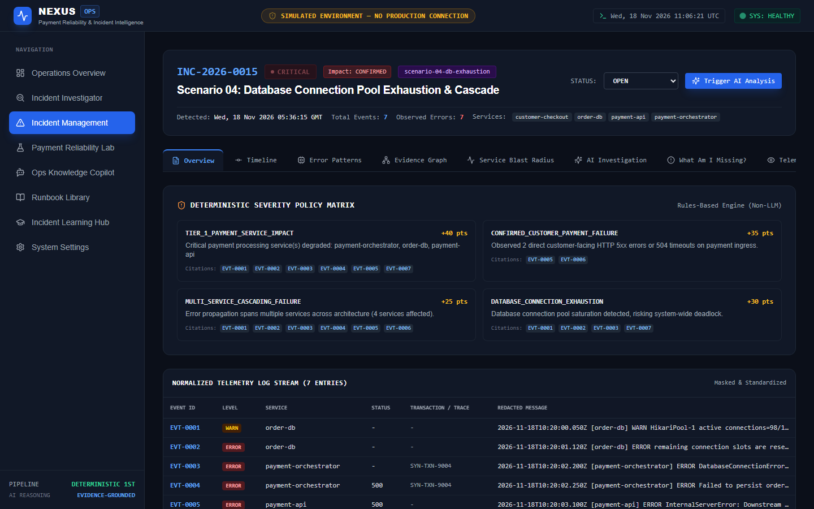
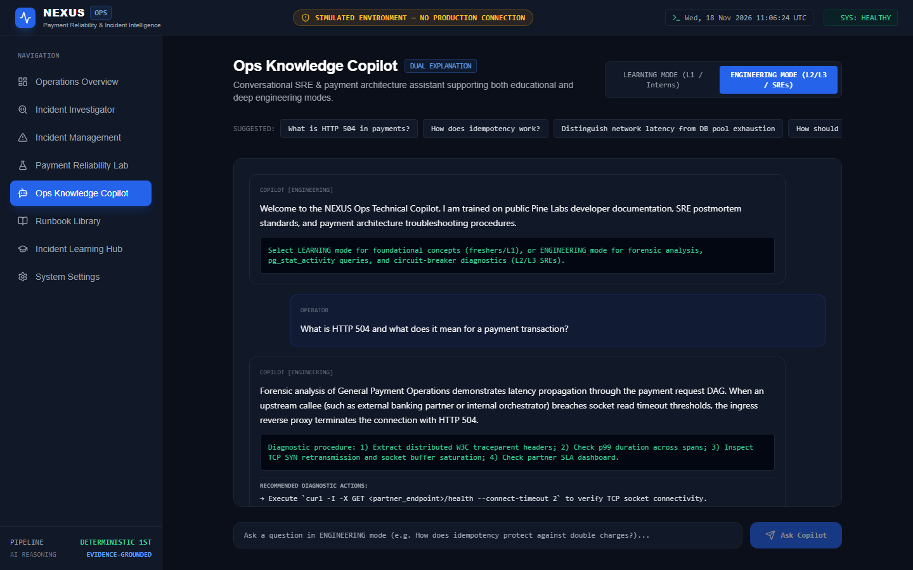
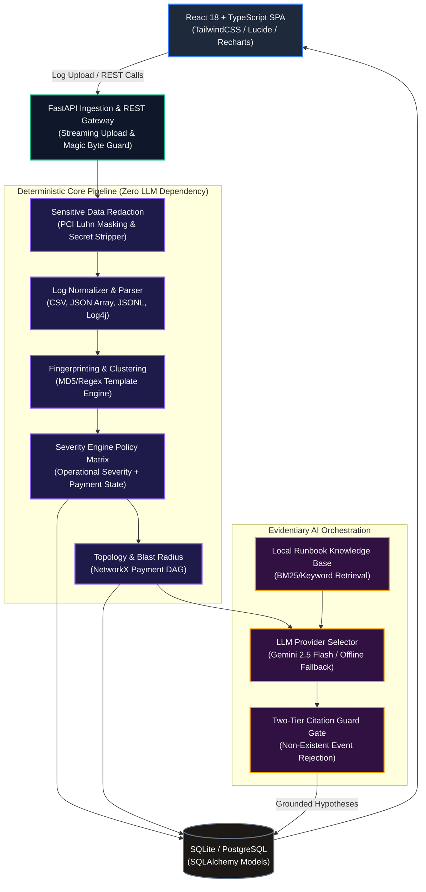
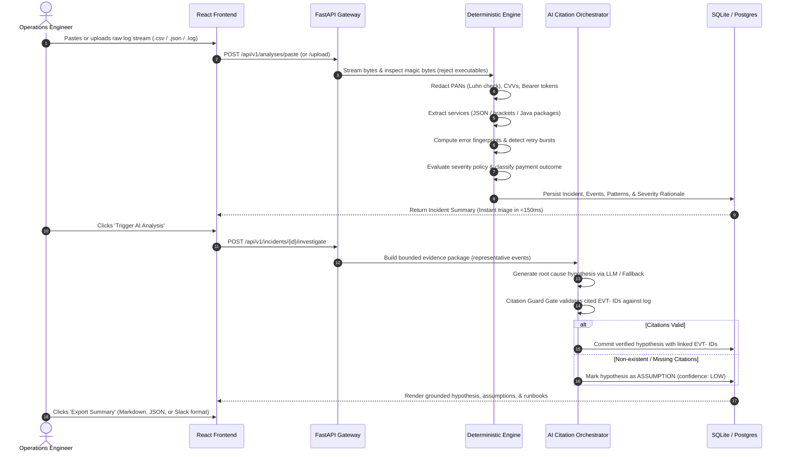

<div align="center">

# NEXUS Ops
### Intelligent Payment Reliability & Incident Intelligence Platform
**Engineered for Technology Operations & SRE Teams**

[](https://github.com/AbhijeetArunGore/nexus-ops/actions/workflows/ci.yml)
[](docs/TESTING.md)
[](https://www.python.org/)
[](https://fastapi.tiangolo.com/)
[](https://react.dev/)
[](https://www.typescriptlang.org/)
[](https://tailwindcss.com/)

---

*Practical AI Assignment 1: AI-Powered Incident Analyzer*  
*Candidate: **Abhijeet Arun Gore** | Target Role: **Technology Operations Intern (Pune)***

</div>

> [!IMPORTANT]
> **SIMULATED ENVIRONMENT NOTICE:** NEXUS Ops operates exclusively on synthetic payment telemetry and simulated microservice architectures. It does not connect to live production payment gateways, customer bank accounts, or cardholder data environments.

---

## 1. Problem Statement & Operations Workflow

In modern fintech architectures handling millions of daily payment transactions, distributed failures cascade within seconds. A support engineer receiving disparate logs after a service disruption faces three acute operational bottlenecks:
1. **Ambiguous Severity:** An HTTP 504 timeout on payment ingress does not prove financial loss; customer funds may have already been debited by the acquiring bank. Conflating technical timeouts with transaction outcomes triggers false alarms or delayed reconciliations.
2. **AI Hallucinations in Operations:** Standard LLMs invent root causes or cite non-existent error lines when ungrounded, making automated recommendations risky for production on-call bridges.
3. **Cognitive Overhead in Triage:** Manually grouping thousands of repetitive stack traces across APIs, orchestrators, databases, and webhook dispatchers consumes critical recovery minutes.

**NEXUS Ops** resolves these challenges by combining **deterministic, rules-first incident classification** with **evidence-grounded AI explanations**. Severity is mathematically determined by policy rules, while the LLM synthesizes readable root-cause hypotheses strictly verified against observed log event citations.

---

## 2. Visual Interface & Operations Workspace

The user interface provides Technology Operations engineers with an end-to-end investigation workspace:

### Operations Command Center
Real-time dashboard summarizing synthetic payment lifecycle telemetry, topology error distribution, and active incident alerts.


### Log Ingestion & Forensic Investigator
Accepts raw logs via copy-paste or drag-and-drop (.log, .txt, .json, .jsonl, .csv) with inline credential masking and 10MB streaming protection.


### Incident Workspace & Severity Matrix
Deep-dive triage presenting mathematical severity point calculations, distinct payment transaction outcomes, and timeline milestones.


### Interactive Evidence Graph
Visual causality graph connecting normalized log events (`EVT-`), failure patterns, policy rules, AI hypotheses, and operational runbooks.


### Payment Scenario Simulation Lab
Eight realistic payment degradation scenarios (late authorizations, DB pool exhaustion, webhook retry storms) for operator training.


### Ops Knowledge Copilot
Grounds conversational operational queries in local SRE runbooks, supporting both Learning Mode (L1 Ops) and Engineering Mode (L2/L3 SRE).


---

## 3. High-Level System Architecture

NEXUS Ops enforces a strict unidirectional pipeline where untrusted logs are sanitized, normalized, and scored deterministically before being passed to the AI investigation layer.



---

## 4. End-to-End Incident Investigation Flow



---

## 5. Key Engineering Differentiators

| Capability | Standard Chatbot / Basic Dashboard | NEXUS Ops Platform |
| :--- | :--- | :--- |
| **Severity Assignment** | Delegated to LLM (non-deterministic, hallucination-prone). | **Mathematical rules-based policy engine**; severity is never decided by an LLM. |
| **Payment Semantics** | Interprets 504 timeout as confirmed financial failure. | **Decouples technical timeouts from financial states** (`AMBIGUOUS`, `PENDING`, `CAPTURED`). |
| **AI Evidence Grounding** | Unverified summaries; presents AI assumptions as confirmed facts. | **Two-Tier Citation Gate**: Hypotheses must cite verified `EVT-` IDs or are marked `ASSUMPTION`. |
| **Zero-Network Resilience**| Crashes or hangs when API keys expire or rate limits hit. | **Deterministic Fallback Provider**: 100% offline uptime with explicit provider transparency. |
| **Data Privacy** | Raw logs sent directly to third-party AI APIs. | **Pre-ingestion inline redaction**: Luhn-validated PAN masking, CVV masking, and secret redaction. |
| **Incident Sharing** | Copy-pasting unstructured text from chat interfaces. | **1-Click Shareable Summary Export**: Formatted for Markdown, JSON, and Slack on-call bridges. |

---

## 6. Quick Start Guide (Windows / Linux / macOS)

### Prerequisites
- Python 3.11+
- Node.js 18+ & npm

### Quick Setup Commands
```bash
# 1. Clone repository
git clone https://github.com/AbhijeetArunGore/nexus-ops.git
cd nexus-ops

# 2. Setup backend
cd backend
python -m venv venv
# Windows: venv\Scripts\activate | Unix: source venv/bin/activate
pip install -r requirements.txt
cp ../.env.example .env
# Optional: Add GEMINI_API_KEY in .env (defaults to offline fallback if omitted)

# 3. Setup frontend
cd ../frontend
npm ci
npm run build

# 4. Seed balanced demo environment & start
cd ..
python scripts/seed_demo.py
# Terminal 1 (Backend API):
python -m uvicorn backend.app.main:app --port 8000 --reload
# Terminal 2 (Frontend UI):
npm --prefix frontend run dev
```
Open **`http://localhost:5173`** to access the Operations Command Center.

---

## 7. Automated Test Suite & Verification

Every reported capability is validated by automated test suites executable on a fresh clone without dependencies on stale local database files:

```bash
# Run 42 backend regression, boundary, and scenario agreement tests
python -m pytest backend/tests/test_api.py backend/tests/test_core.py backend/tests/test_scenarios.py backend/tests/test_golden_scenarios.py -v

# Run AI answer quality and citation attribution evaluation
python backend/tests/evaluate_ai_quality.py

# Run frontend TypeScript typecheck
npm --prefix frontend run type-check
```

- **Backend Pytest Suite:** **42/42 Passed** (100%) in 1.4s on isolated temporary databases.
- **AI Evaluation Suite:** **8/8 Evaluation categories passed** with **97.5% mean concept recall** and 0 unsupported citations using the deterministic fallback provider.
- **Frontend Typecheck:** 0 TypeScript compilation errors (`tsc --noEmit`).

---

## 8. Candidate Contribution vs AI-Assisted Work

- **Individual Engineering Contribution (Abhijeet Arun Gore):**
  - Architected the core deterministic severity engine, separating technical errors from payment transaction outcomes.
  - Designed the two-tier citation verification gate to prevent hallucinated evidence IDs.
  - Authored the 8 realistic payment lifecycle scenarios based on Pine Labs payment architectures.
  - Built the pytest session fixtures guaranteeing reproducible fresh-clone test runs.
  - Conducted end-to-end browser verification, defect audits, and documentation synchronization.
- **AI-Assisted Tools (Antigravity / Gemini):**
  - Accelerated initial FastAPI boilerplate router definitions and Tailwind UI styling.
  - Assisted in generating standard regex patterns for log timestamp and Luhn validation.
  - Formatted technical postmortem outlines and initial runbook drafts.

---

## 9. Disclosed Engineering Limitations

1. **Telemetry Ingestion Mode:** Ingestion is batch-oriented (up to 10MB via HTTP upload or copy-paste), not continuous Kafka or eBPF streaming.
2. **Database Runtime:** SQLite is the verified local test database. SQLAlchemy models and Alembic migrations support PostgreSQL, but live PostgreSQL runtime was not exercised.
3. **Docker Runtime:** `docker-compose.yml` and `Dockerfile` syntax are validated, but live container runtime remains unverified if Docker Engine is not running locally.
4. **AI Provider Testing:** Automated evaluation scripts evaluate the deterministic fallback provider (`DeterministicFallbackProvider`) by default. Live Gemini 2.5 Flash is exercised when `GEMINI_API_KEY` is provided in `.env`.

---

## 10. Deep Documentation & Architecture Links

- [Requirements Traceability Matrix](docs/FINAL_REQUIREMENT_TRACEABILITY.md)
- [10-Minute Demonstration Script](docs/DEMO_SCRIPT.md)
- [Technical Q&A Preparation Bank](docs/QA_PREP.md)
- [Payment Scenario Catalog](docs/SCENARIOS.md)
- [System Architecture & 18 Subsystems](docs/ARCHITECTURE.md)
- [AI Engineering & Grounding Design](docs/AI_ENGINEERING.md)
- [Comprehensive Testing Report](docs/TESTING.md)
