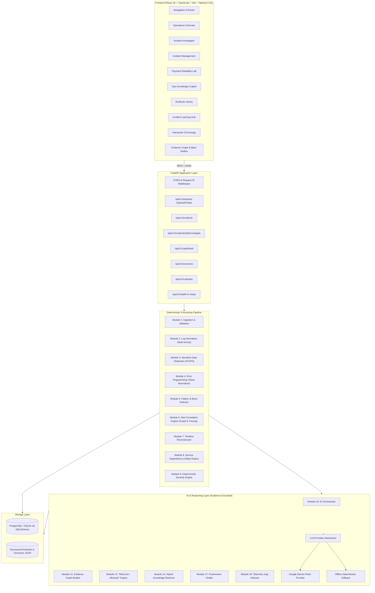

# NEXUS Ops — Master System Architecture

> **Tagline:** From Operational Signals to Explainable Incident Intelligence  
> **Environment Note:** SIMULATED ENVIRONMENT — NO PRODUCTION SYSTEM CONNECTION.  
> Inspired by publicly documented payment processing lifecycles (order creation, authorization, webhook dispatch, UTR-reconciled settlements, and refunds).

---

## 1. High-Level Architecture Overview

NEXUS Ops is engineered as a **Modular Monolith** designed for Technology Operations, SREs, and Application Support engineers in payment and fintech enterprises. It decouples high-volume deterministic telemetry processing from evidence-grounded AI reasoning.

---

## 2. Core Philosophy: Deterministic First + Evidence AI Second

A fundamental flaw in naive AIOps tooling is sending raw logs directly to an LLM. This leads to hallucinations, non-reproducible severity ratings, security leaks (e.g., exposing credentials or customer PANs), and high inference latency.

NEXUS Ops enforces the following strict pipeline:
1. **Deterministic Layer (Facts):** Normalizes, redacts, fingerprints, groups bursts, reconstructs the timeline, maps service dependencies, and computes severity using deterministic mathematical rules.
2. **AI Layer (Reasoning):** Accepts a compact, pre-structured **Investigation Package** with real event IDs. The LLM acts as an analytical hypothesis generator and communicator, not an arbitrary decision-maker.
3. **Verification Layer:** Cross-validates all AI-generated citations against real ingested event IDs. Non-existent citations are rejected.

---

## 3. Communication Requirements: Dual Explanation

### 3.1 Simple Explanation (For Conceptual Understanding)
Think of an incident at a payment gateway like an emergency room. When multiple alarms go off at once, doctors cannot stop to read thousands of lines of raw monitor output. 
- **The Deterministic Engine** acts as the triage nurse: it takes vitals, removes private patient identifiers, groups symptoms, checks established protocol rules, and determines whether the patient is in critical condition.
- **The AI Layer** acts as the consulting specialist: it reviews the organized triage chart, reviews medical textbooks (runbooks), forms diagnostic hypotheses (e.g., "The patient may have suffered a database timeout"), points to exact symptoms as proof, and asks "What did we forget to test?".
- **The Human Engineer** always stays in control: the doctor makes the final diagnosis, confirms the treatment, and records the lessons learned.

### 3.2 Professional Technical Explanation (For Interviews)
NEXUS Ops uses an asynchronous, pipe-and-filter modular monolith built on FastAPI, Pydantic v2, and SQLAlchemy. Telemetry ingestion handles heterogeneous unstructured log formats (standard text, JSONL, Python stack traces, Java Log4j/Logback, HTTP access logs) with streaming validation and regex-based PII/PCI-DSS data sanitization. 

The deterministic engine performs token-masked error fingerprinting (stripping UUIDs, transaction hashes, IPs, and timestamps) and temporal-topological event correlation over a configurable service dependency DAG modeled in NetworkX. Severity calculation evaluates eight dimensional criteria (service criticality, blast radius, error velocity, cascading depth, and payment state impact) under an explainable policy matrix. 

The AI orchestration layer enforces bounded context windows by serializing normalized investigation payloads into Pydantic-validated JSON schemas using Google Gemini Flash with fallback to offline heuristic reasoning. The system guarantees that every hypothesis references verifiable, ingested event identifiers (`E-xxx`), completely eliminating ungrounded hallucinations.

---

## 4. Component Boundaries & Responsibilities

| Component | Responsibility | Tech Selection | Why Not Alternatives? |
| :--- | :--- | :--- | :--- |
| **Frontend** | Responsive dashboard, timeline visualization, blast radius graph, interactive evidence inspection, copilot chat. | React 18, Vite, TypeScript, Tailwind CSS, Lucide icons, Recharts | Avoided heavy enterprise UI suites (e.g. Ant Design) to keep bundle small, modern, and customizable. |
| **Backend API** | High-performance asynchronous REST endpoints, request validation, CORS, error handling. | FastAPI (Python 3.12), Pydantic v2 | Selected over Django/Flask because FastAPI provides native async, automatic OpenAPI generation, and sub-millisecond Pydantic v2 serialization. |
| **Data Normalizer & Redaction** | Stream parsing of multi-format logs, masking API keys, JWTs, card PANs, and phone numbers. | Custom streaming parser + compiled RegEx engines | Avoided full heavy log agents (Logstash/Fluentbit) to allow zero-dependency, in-browser/local execution and instant turnaround. |
| **Fingerprint & Pattern Engine** | Clustering repeated log lines, detecting error rate spikes and cascading patterns. | Token-based normalization + sliding-window aggregations | Avoided complex ML clustering (DBSCAN/K-Means) for runtime predictability and deterministic explainability. |
| **Correlation & Blast Radius** | Directed acyclic graph representation of payment services, tracing cascades, blast radius calculation. | NetworkX + Topological Traversal | Avoided Neo4j graph database to eliminate JVM operational overhead for micro/single-node deployment. |
| **Severity Engine** | Deterministic 4-tier severity (CRITICAL, HIGH, MEDIUM, LOW) evaluated against explicit rules. | Rule-based decision matrix with explainability metadata | Prohibited LLM-based severity scoring to prevent prompt-injection downgrades and compliance violations. |
| **AI Orchestrator** | Prompt formatting, structured schema validation, hypothesis generation, postmortem drafting. | Direct SDK / HTTP REST with Pydantic JSON schemas | Avoided LangChain/LangGraph because direct orchestration yields zero bloat, deterministic retries, lower latency, and zero hidden prompt injections. |
| **Storage Layer** | Relational storage for incidents, normalized events, fingerprints, evidence, and audit logs. | PostgreSQL / SQLite via SQLAlchemy ORM | Dual dialect support allows zero-friction local developer testing on SQLite and seamless PostgreSQL deployment in Docker. |

---

## 5. Security & Isolation Boundaries

1. **Simulated Boundary:** The platform explicitly flags all data with `environment: "simulated"` and displays the banner: `SIMULATED ENVIRONMENT — NO PRODUCTION SYSTEM CONNECTION`.
2. **Zero Ingestion of Real Payment Data:** All payment references follow synthetic formats (`SYN-TXN-XXXX`, `SYN-ORD-XXXX`).
3. **Redaction Guarantee:** Any string matching token, bearer, API key, email, phone, or credit card formats is replaced with `[REDACTED_SECRET]` before hitting the database or AI layer.
4. **No Direct Execution Agency:** NEXUS Ops recommends remediation runbooks and verification steps; it has zero privileges to execute shell commands, refund money, or modify live production systems.
