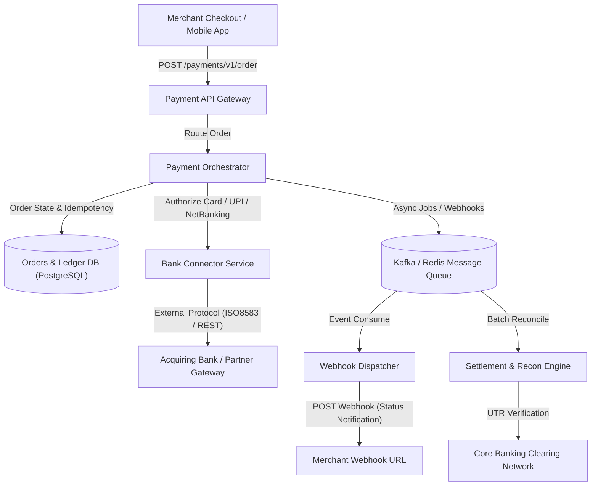

# NEXUS Ops — Master System Design & Engineering Specification

---

## 1. Data Flow Architecture

The data pipeline transitions from unstructured text to structured, explainable incident intelligence:

```
[Raw Log File / Paste Input]
           │
           ▼
[Module 1: Ingestion & Validation]
  - Check file size limit (<10MB)
  - Verify UTF-8 encoding
  - Split lines, reject malicious executable headers
           │
           ▼
[Module 2: Log Normalization]
  - Detect format: JSON, Java Log4j/Logback, Python Trace, Access Log, Syslog
  - Extract: timestamp, log_level, service, message, error_type, transaction_id, trace_id, http_status
           │
           ▼
[Module 3: Sensitive Data Redaction]
  - Scan with regex masks: Bearer tokens, API keys, card PANs, CVVs, Passwords, Emails, Phone numbers
  - Flag: redaction_applied = true
           │
           ▼
[Module 4: Error Fingerprinting]
  - Strip variable tokens: GUIDs, hex addresses, numbers, timestamps, transaction IDs
  - Generate SHA-256 pattern hash -> Group repeated occurrences
           │
           ▼
[Module 5: Pattern & Burst Detection]
  - Calculate frequency, burst rate, time window, error types
  - Flag: CASCADE, BURST, TIMEOUT, DB_CONN_EXHAUSTION, WEBHOOK_FAILURE
           │
           ▼
[Module 6: Alert Correlation Engine]
  - Group by shared trace_id, transaction_id, service dependency link, or tight temporal window (±15s)
  - Score correlation strength: HIGH (Shared ID), MEDIUM (Graph connection), LOW (Temporal only)
           │
           ▼
[Module 7 & 8: Timeline & Blast Radius]
  - Order events by timestamp
  - Identify First Observed Event vs Earliest Underlying Cause vs First Customer Impact
  - Traverse Service Dependency DAG (NetworkX) to compute Observed Impact vs Potential Blast Radius
           │
           ▼
[Module 9: Deterministic Severity Engine]
  - Evaluate rules against Service Criticality, Error Rate, Payment State Impact, Cascade Depth
  - Assign: CRITICAL, HIGH, MEDIUM, LOW + Explicit rationale list
           │
           ▼
[Module 10 & 11: AI Investigation & Evidence Graph]
  - Compile compact Investigation Package
  - Send to LLM with Strict Pydantic JSON Schema
  - Validate output: Verify all cited event IDs exist in the normalized event store
  - Construct Evidence Graph linking Events -> Patterns -> Hypotheses -> Recommendations
           │
           ▼
[Postgres / SQLite Store] & [Frontend Workspace Render]
```

---

## 2. Relational Database Schema & Data Dictionary

### 2.1 Core Entities

1. **`incidents`**
   - `id`: UUID (Primary Key)
   - `incident_number`: String (e.g., `INC-2026-001`, unique)
   - `title`: String
   - `severity`: Enum (`CRITICAL`, `HIGH`, `MEDIUM`, `LOW`)
   - `status`: Enum (`OPEN`, `INVESTIGATING`, `MITIGATED`, `RESOLVED`, `CLOSED`)
   - `customer_impact`: Enum (`CONFIRMED`, `SUSPECTED`, `UNKNOWN`)
   - `source_scenario`: String (null if ad-hoc upload)
   - `created_at`: DateTime (UTC)
   - `updated_at`: DateTime (UTC)
   - `resolved_at`: DateTime (UTC, nullable)
   - `summary`: Text
   - `severity_rationale`: JSONB / Text

2. **`log_events`**
   - `id`: UUID (Primary Key)
   - `incident_id`: UUID (Foreign Key -> incidents.id)
   - `event_id`: String (e.g., `EVT-001`, unique within incident)
   - `timestamp`: DateTime (UTC, nullable)
   - `service`: String (e.g., `payment-api`, `bank-connector`)
   - `environment`: String (`simulated`)
   - `log_level`: String (`INFO`, `WARN`, `ERROR`, `FATAL`)
   - `message`: Text (redacted)
   - `error_type`: String (nullable, e.g., `TimeoutError`, `DatabaseConnectionError`)
   - `trace_id`: String (nullable)
   - `span_id`: String (nullable)
   - `transaction_id`: String (nullable, e.g., `SYN-TXN-1002`)
   - `endpoint`: String (nullable)
   - `http_status`: Integer (nullable)
   - `duration_ms`: Float (nullable)
   - `dependency`: String (nullable)
   - `fingerprint`: String (nullable)
   - `redaction_applied`: Boolean
   - `line_number`: Integer

3. **`error_patterns`**
   - `id`: UUID (Primary Key)
   - `incident_id`: UUID (Foreign Key -> incidents.id)
   - `fingerprint`: String (SHA-256 hash of normalized pattern)
   - `service`: String
   - `error_type`: String
   - `pattern_template`: Text
   - `occurrence_count`: Integer
   - `first_seen`: DateTime
   - `last_seen`: DateTime
   - `sample_event_ids`: JSON / Text

4. **`correlated_groups`**
   - `id`: UUID (Foreign Key -> incidents.id)
   - `correlation_type`: String (`SHARED_TRANSACTION`, `SHARED_TRACE`, `DEPENDENCY_CASCADE`, `TEMPORAL_WINDOW`)
   - `strength`: Enum (`HIGH`, `MEDIUM`, `LOW`)
   - `rationale`: Text
   - `event_ids`: JSON / Text

5. **`evidence_records`**
   - `id`: UUID (Primary Key)
   - `incident_id`: UUID (Foreign Key -> incidents.id)
   - `evidence_code`: String (e.g., `E-001`)
   - `title`: String
   - `description`: Text
   - `source_event_ids`: JSON / Text
   - `confidence`: Enum (`HIGH`, `MEDIUM`, `LOW`)

6. **`hypotheses`**
   - `id`: UUID (Primary Key)
   - `incident_id`: UUID (Foreign Key -> incidents.id)
   - `hypothesis_code`: String (e.g., `H-001`)
   - `title`: String
   - `description`: Text
   - `confidence`: Enum (`HIGH`, `MEDIUM`, `LOW`)
   - `supporting_evidence_codes`: JSON / Text
   - `contradicting_evidence_codes`: JSON / Text
   - `verification_steps`: JSON / Text
   - `is_primary`: Boolean

7. **`recommendations`**
   - `id`: UUID (Primary Key)
   - `incident_id`: UUID (Foreign Key -> incidents.id)
   - `priority`: Integer (1, 2, 3...)
   - `action`: Text
   - `rationale`: Text
   - `associated_runbook_id`: String (nullable)
   - `verification_step`: Text

8. **`runbooks`**
   - `id`: String (Primary Key, e.g., `RB-PAY-001`)
   - `title`: String
   - `category`: String
   - `applicable_services`: JSON / Text
   - `symptoms`: JSON / Text
   - `investigation_steps`: JSON / Text
   - `escalation_conditions`: Text
   - `recovery_verification`: Text
   - `provenance`: String (`SIMULATED_REFERENCE` / `OFFICIAL_DOC_REF`)

9. **`incident_feedback`** (Incident Learning Hub)
   - `id`: UUID (Primary Key)
   - `incident_id`: UUID (Foreign Key -> incidents.id)
   - `verified_root_cause`: Text
   - `hypothesis_accuracy`: Enum (`VERIFIED`, `PARTIAL`, `REJECTED`)
   - `useful_recommendations`: JSON / Text
   - `remediation_notes`: Text
   - `reviewed_by`: String
   - `reviewed_at`: DateTime

10. **`postmortems`**
    - `id`: UUID (Primary Key)
    - `incident_id`: UUID (Foreign Key -> incidents.id)
    - `status`: Enum (`DRAFT`, `REVIEWED`, `APPROVED`)
    - `executive_summary`: Text
    - `timeline`: JSON / Text
    - `root_cause_analysis`: Text
    - `what_went_well`: JSON / Text
    - `what_went_wrong`: JSON / Text
    - `detection_gaps`: JSON / Text
    - `action_items`: JSON / Text
    - `generated_at`: DateTime

---

## 3. Synthetic Pine Labs Payment Topology

To realistically analyze payment workflows, NEXUS Ops models the standard Pine Labs payment lifecycle dependency DAG:



### Criticality Tiers:
- **Tier 1 (Mission Critical):** `APIGateway`, `PaymentOrchestrator`, `OrderDB`, `BankConnector` (Failure blocks money movement -> immediate HIGH/CRITICAL).
- **Tier 2 (High):** `WebhookDispatcher`, `MessageQueue` (Failure delays notifications, but transactions may have succeeded).
- **Tier 3 (Medium):** `SettlementEngine` (Batch clearing; asynchronous retryable).
- **External Dependencies:** `ExternalPaymentPartner`, `MerchantEndpoint`, `CoreBankingPartner`.

---

## 4. API Specification (FastAPI REST Endpoints)

All responses conform to structured envelope standards:
```json
{
  "success": true,
  "data": {},
  "error": null,
  "metadata": {
    "request_id": "req-12345",
    "timestamp": "2026-11-18T14:15:00Z",
    "environment": "simulated"
  }
}
```

### Endpoints:
- `GET /api/v1/health`: System health and dependency status.
- `POST /api/v1/analyses/upload`: Multipart file upload for log files (.log, .txt, .json, .csv).
- `POST /api/v1/analyses/paste`: Raw text payload paste.
- `GET /api/v1/analyses/{analysis_id}`: Full analysis status and summary.
- `GET /api/v1/incidents`: List all incidents with filters (severity, status, service).
- `GET /api/v1/incidents/{incident_id}`: Incident details including normalized events, error patterns, correlation groups, timeline, and severity rationale.
- `PATCH /api/v1/incidents/{incident_id}/status`: Update incident lifecycle status (`OPEN`, `INVESTIGATING`, `MITIGATED`, `RESOLVED`, `CLOSED`).
- `POST /api/v1/incidents/{incident_id}/investigate`: Trigger AI investigation layer for root cause hypotheses, evidence graph, and troubleshooting recommendations.
- `POST /api/v1/incidents/{incident_id}/what-am-i-missing`: Trigger second-pass adversarial analysis challenging initial assumptions.
- `POST /api/v1/incidents/{incident_id}/ask`: Ops Copilot conversational Q&A endpoint supporting `LEARNING` and `ENGINEERING` modes.
- `GET /api/v1/incidents/{incident_id}/evidence-graph`: Structured graph nodes and edges linking events, patterns, hypotheses, and recommendations.
- `GET /api/v1/incidents/{incident_id}/blast-radius`: Topological downstream impact graph distinguishing `OBSERVED_IMPACT` from `POTENTIAL_BLAST_RADIUS`.
- `GET /api/v1/incidents/{incident_id}/telemetry-gaps`: List missing telemetry signals and instrumentation recommendations.
- `POST /api/v1/incidents/{incident_id}/feedback`: Human-in-the-loop review and root cause confirmation.
- `POST /api/v1/incidents/{incident_id}/postmortem`: Generate or update drafted postmortem.
- `GET /api/v1/scenarios`: List the 8 Pine Labs-inspired payment simulation scenarios.
- `POST /api/v1/scenarios/{scenario_id}/run`: Ingest and analyze a pre-built synthetic scenario end-to-end.
- `GET /api/v1/runbooks`: Retrieve runbooks from the knowledge base.
- `GET /api/v1/knowledge/search`: Hybrid keyword and semantic search across payment documentation and runbooks.
